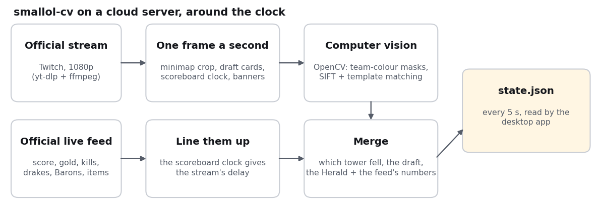
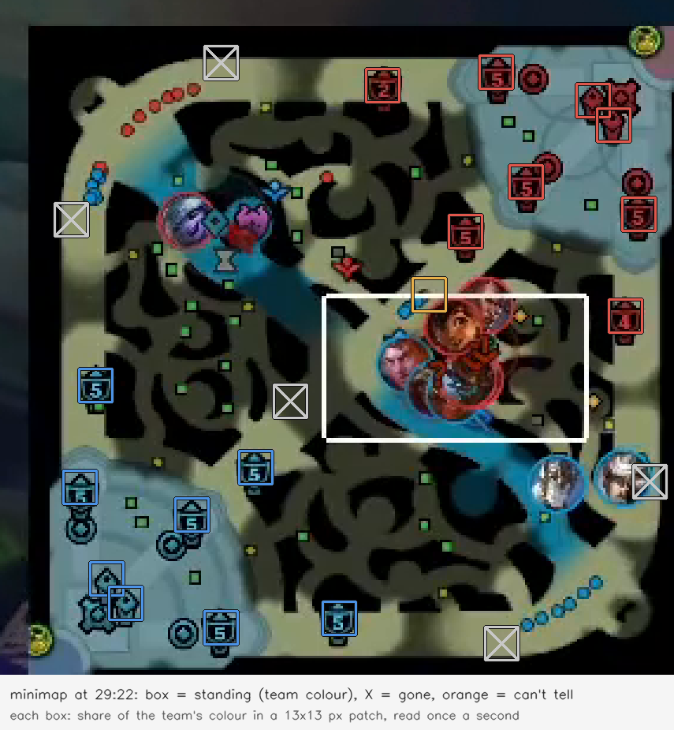
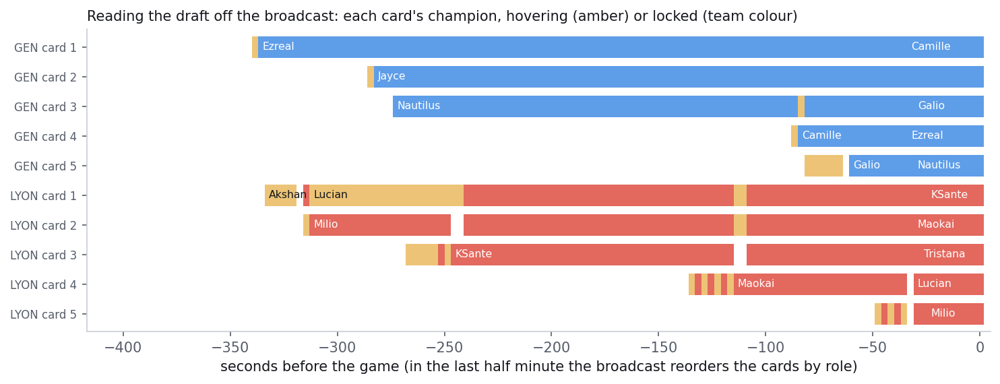

# smallol-cv

The data service behind [SmalLoL](https://github.com/Zaious/smallol), an unofficial desktop companion for League of Legends esports.

It watches a live LoL Esports broadcast and the official live feed, and serves the state of the match as one JSON document (`state.json`) that the desktop app reads every five seconds.

> **Status: early.** Built and run during the 2026 World Championship Play-Ins, tuned on the 2026 Worlds broadcast layout at 1080p. Expect the readers to need retuning when the broadcast overlay changes.



## What it reads, and from where

| Piece | Source |
| --- | --- |
| Score, gold, kills, levels, items, drakes, barons, inhibitors, tower counts | Official LoL Esports live feed (`feed.lolesports.com`) |
| Which tower fell | The minimap in the broadcast picture (`tools/live_classify.py`, `tools/trigger_sim_clf4.py`) |
| Picks and bans while the draft is on | The broadcast's draft overlay (`tools/draft_picks.py`) |
| Herald | The broadcast's kill banner (`tools/herald_banner2.py`) |
| Schedule, series score, rosters, this event's history | LoL Esports API and Leaguepedia (`tools/archive.py`, `tools/build_teamsheet.py`) |

The feed says how many towers a team has lost, but not which ones. The minimap does: each tower site is a small patch, and the share of the team's colour in it says whether the tower is standing, gone, or hidden under a champion or an effect. The service reads it once a second and names a tower when the feed's count goes up and the minimap has shown that site gone for long enough.



During the draft, the broadcast's pick cards are read every second: which champion is on each card, and whether the player is still hovering it or has locked it in. The bans are read the same way.



Both figures come from one recorded game (`tools/readme_figures_data.py` on the server, `tools/readme_figures_plot.py` to draw).

The format of `state.json` is in [docs/SERVICE_CONTRACT.md](docs/SERVICE_CONTRACT.md) (Chinese), with samples in `docs/samples/`.

## Run it

You need Python 3.10+, ffmpeg and Node.js 18+.

```bash
pip install -r requirements-outpost.txt      # numpy, opencv-python-headless, yt-dlp
python tools/fetch_ddragon_splash.py         # champion art for the draft reader (see hero-art/README.md)
python tools/fetch_ddragon_icons.py          # champion icons and list (see hero-icons/README.md)
```

The LoL Esports API needs the `x-api-key` header that the lolesports.com site itself sends. It is not in this repo; put it in the environment as `LOL_API_KEY`. The live feed itself needs no key.

Everything at once (what the public instance runs):

```bash
LOL_API_KEY=... STREAM_URL=https://www.twitch.tv/riotgames APP_PORT=8787 python tools/outpost_run.py
```

or the three parts by hand:

```bash
LOL_API_KEY=... node tools/live_feed_log.mjs data/live_worlds2026                          # official feed log
python tools/live_watch.py https://www.twitch.tv/riotgames data/live_worlds2026            # stream -> 1 fps frames -> readers
LOL_API_KEY=... python tools/live_service.py --dir data/live_worlds2026 --port 8787        # http://127.0.0.1:8787/state.json
```

`live_watch.py` waits until the channel is live, pulls the stream with yt-dlp and ffmpeg, and keeps no video. YouTube asks data-centre addresses to sign in, so a server should pull from Twitch; at home either works. The broadcast runs some 30–45 seconds behind the feed; the service measures the delay itself.

`data/` (feed logs, readings, the history archive) is not in the repo. Without `data/archive/` the service still serves `state.json` and `schedule.json`; `teams.json` and `/history/*` return 404 until `tools/archive.py` and `tools/build_teamsheet.py` have run.

### Endpoints

`/state.json`, `/schedule.json`, `/teams.json`, `/history/teams.json`, `/history/players.json`, `/history/games.json`, `/history/game/<gameId>.json`, `/healthz`.

## What is not here

Recordings, extracted frames and Riot's champion art are not committed, apart from the one minimap frame in `docs/media/minimap.png`. `tools/` also holds the experiments that led to the current readers; the live path is the files named above.

## Licence

Apache License 2.0, see [LICENSE](LICENSE) and [NOTICE](NOTICE).

smallol-cv isn't endorsed by Riot Games and doesn't reflect the views or opinions of Riot Games or anyone officially involved in producing or managing Riot Games properties. Riot Games, and all associated properties are trademarks or registered trademarks of Riot Games, Inc.
